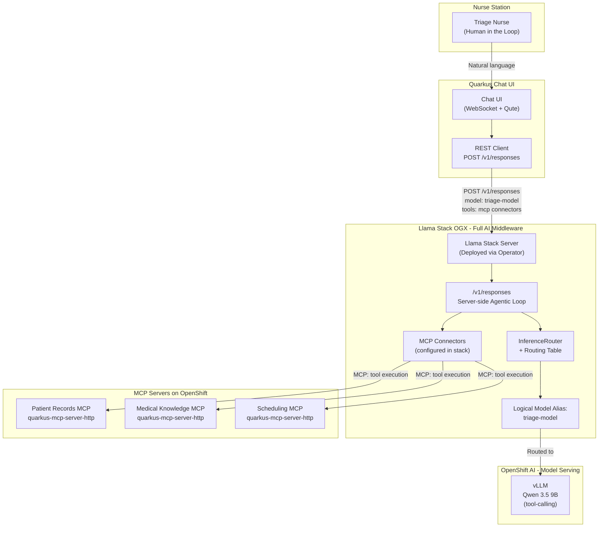
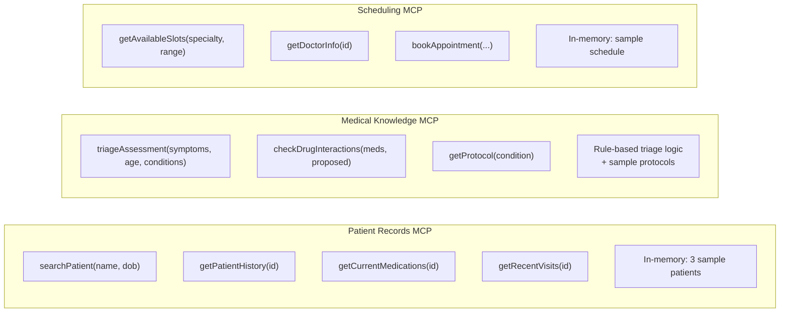
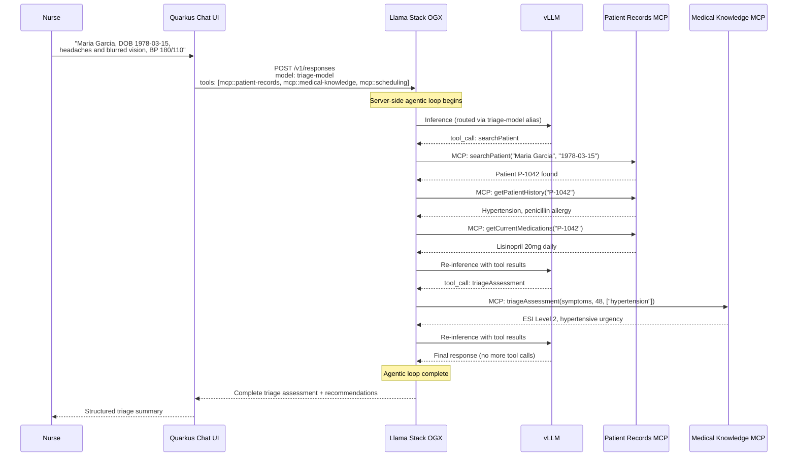
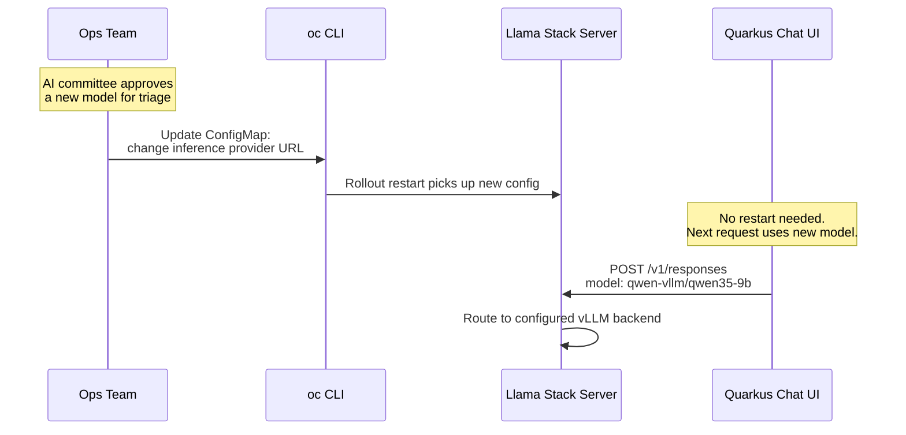
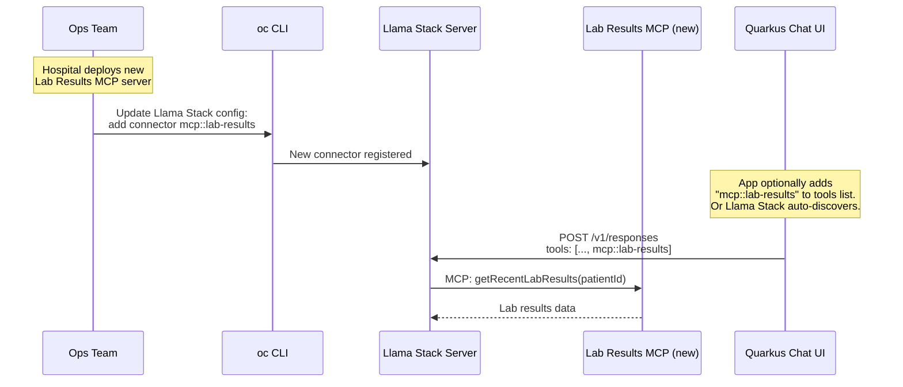

# Architecture

## System Overview

The Patient Triage Assistant is a multi-layered system where **Llama Stack (OGX)** serves as the full AI middleware -- handling model routing, MCP tool execution, and server-side agentic orchestration. The Quarkus application is a thin chat UI that delegates all AI logic to Llama Stack.



## The Key Insight: Llama Stack as Full Middleware

**Llama Stack handles everything** -- model routing, MCP tool discovery and execution, and the agentic orchestration loop:

| Responsibility | Owner |
|---------------|-------|
| Model routing | Llama Stack (routing table / models config) |
| MCP tool discovery | Llama Stack (connectors) |
| MCP tool execution | Llama Stack (server-side) |
| Agentic loop (inference -> tool call -> re-inference) | Llama Stack (`/v1/responses`) |
| Model switching | Platform team (update Llama Stack ConfigMap + restart) |
| Tool switching | Platform team (update connectors in Llama Stack config) |
| Chat UI + system prompt | Application team (Quarkus app) |

**What this means for governance:**
- The **platform team** controls which models AND which tools are available -- via Kubernetes CRs and Llama Stack config
- The **application team** builds the UI and defines the system prompt
- Adding a new MCP server (e.g., a lab results tool) requires zero application changes -- just add a connector in Llama Stack

## Layer-by-Layer Justification

### 1. OpenShift AI + vLLM (Model Serving)

**What:** An LLM deployed as an `InferenceService` custom resource, running vLLM as the serving runtime with OCI/ModelCar storage.

**Why it must exist:**
- HIPAA and GDPR mandate that patient data (symptoms, medical history, medication lists) never leaves the hospital's infrastructure
- Cloud LLM APIs (OpenAI, Anthropic, Google) are not an option for processing PHI (Protected Health Information)
- vLLM provides OpenAI-compatible endpoints, making it transparent to Llama Stack

**Model:**

| Model | Role | GPU Footprint |
|-------|------|---------------|
| Qwen 3.5 9B | All tasks: patient lookup, triage, drug interactions, scheduling -- excellent tool calling | 1x NVIDIA GPU, quantized, tensor-parallel-size=1 |

The model weights are distributed as a ModelCar OCI image (`oci://quay.io/nlembers/qwen35-9b-fp8-modelcar:latest`), pulled directly by KServe from the container registry. The InferenceService is internal-only via cluster Service (no external Route). Llama Stack accesses it at `http://qwen35-9b-predictor:8080`.

Note: Llama Stack is model-agnostic. Any model with an OpenAI-compatible API can be swapped in by deploying a new InferenceService and updating the Llama Stack provider config.

### 2. Llama Stack (OGX) via Operator (Full AI Middleware)

**What:** A Llama Stack server deployed via the Llama Stack Operator (`LlamaStackDistribution` CR). Provides:
- OpenAI-compatible inference routing (`/v1/chat/completions`, `/v1/models`)
- Server-side agentic orchestration (`/v1/responses`) with MCP tool execution
- MCP connector management for external tool servers

**Why it must exist:**
- **Model governance:** The hospital's AI committee approves models for clinical use. The ops team controls which model serves which alias -- without developer involvement
- **Tool governance:** The platform team controls which MCP servers (hospital systems) the agent can access. Adding or removing tools is a config change, not a code change
- **Server-side orchestration:** The entire agentic loop (inference -> tool calls -> MCP execution -> re-inference -> final response) runs inside the cluster, inside Llama Stack. Patient data never reaches the client application during tool execution
- **Decoupling:** The Quarkus application references a logical model name and tool connectors. Models and tools can be swapped, upgraded, or A/B tested as platform operations
- **Audit trail:** Llama Stack can log which model version produced which response, and which tools were invoked -- critical for clinical AI accountability

**Configuration (OGX v2 config format -- see `k8s/llamastack/configmap-stack-config.yml`):**

```yaml
version: 2
image_name: rh-dev
providers:
  inference:
    - provider_id: qwen-vllm
      provider_type: remote::vllm
      config:
        base_url: http://qwen35-9b-predictor:8080/v1
        max_tokens: 2048

registered_resources:
  models:
    - model_id: triage-model
      provider_id: qwen-vllm
      provider_model_id: qwen35-9b
      model_type: llm

connectors:
  - connector_id: "mcp::patient-records"
    connector_type: mcp
    url: "http://mcp-patient-records:8080/mcp"
  - connector_id: "mcp::medical-knowledge"
    connector_type: mcp
    url: "http://mcp-medical-knowledge:8080/mcp"
  - connector_id: "mcp::scheduling"
    connector_type: mcp
    url: "http://mcp-scheduling:8080/mcp"
```

On OpenShift, the config is stored in a ConfigMap (`triage-llamastack-config`) and referenced by the `LlamaStackDistribution` CR via `userConfig`. The `remote::vllm` provider auto-registers the model as `qwen-vllm/qwen35-9b` (provider-prefixed). The model is also registered with a logical alias `triage-model` via the `registered_resources` section.

### 3. Quarkus (Thin Chat UI)

**What:** A Quarkus application that provides the chat UI and sends requests to Llama Stack's `/v1/responses` endpoint. It does **not** handle MCP tool execution or the agentic loop.

**Why it must exist:**
- This is the **production application** running on nurse stations -- it needs to be fast, observable, and maintainable
- Quarkus provides fast startup, low memory, WebSocket support, and native image capability
- The application defines the **system prompt** (the clinical triage context) and manages **conversation sessions**
- It is intentionally thin: all AI orchestration, model routing, and tool execution are delegated to Llama Stack

**What the Quarkus app does:**
- Presents a chat UI (WebSocket + HTML)
- Maintains session/conversation state
- Sends user messages to `POST /v1/responses` on Llama Stack with the system prompt and MCP tool references
- Renders the final response to the nurse

**What the Quarkus app does NOT do:**
- No MCP client configuration
- No tool execution
- No agentic loop management
- No direct model calls

**Conceptual request to Llama Stack:**

```json
{
  "model": "triage-model",
  "instructions": "You are a clinical triage assistant for hospital nurses...",
  "input": "Patient Maria Garcia, DOB 1978-03-15, headaches and blurred vision...",
  "tools": [
    { "type": "mcp", "connector_id": "mcp::patient-records" },
    { "type": "mcp", "connector_id": "mcp::medical-knowledge" },
    { "type": "mcp", "connector_id": "mcp::scheduling" }
  ]
}
```

### 4. MCP Servers (Agent Tools)

**What:** Three Quarkus microservices, each exposing domain-specific tools via the Model Context Protocol (Streamable HTTP transport). These are consumed by **Llama Stack** (not by the Quarkus chat UI).

**Why MCP (not direct REST or hardcoded tools):**
- **Standardized discovery:** Llama Stack discovers tool descriptions (name, parameters, return type) automatically via MCP protocol
- **Decoupled:** Add, remove, or update MCP servers by changing Llama Stack's connector config -- no application changes
- **Ecosystem:** MCP is an open standard; these servers could be consumed by any MCP-compatible client

**Why self-contained mocks (not real backends):**
- For the webinar demo, each MCP server contains hardcoded sample data
- In production, the `@Tool` methods would call real EHR APIs, scheduling APIs, etc.
- The architecture is identical either way -- only the implementation behind `@Tool` changes



## Data Flow: A Single Triage Interaction

The critical difference from a traditional architecture: **the Quarkus app sends one request and gets back one final response.** All tool execution happens inside Llama Stack.



## Model-Agnostic Architecture

The app doesn't touch models OR tools -- both are platform operations. To swap the model behind Llama Stack (e.g., from Mistral to Granite or Qwen), the platform team updates the ConfigMap with a new `remote::vllm` provider URL (pointing at a different InferenceService) and restarts the Llama Stack pod. The Quarkus app is unaffected -- it continues calling Llama Stack's `/v1/responses` endpoint.



## Tool Switch Flow

Adding a new MCP server (e.g., lab results) is also a platform operation.



## Network Topology on OpenShift

```
┌──────────────────────────────────────────────────────────────┐
│ OpenShift Cluster                                            │
│                                                              │
│  ┌──────────────────────────────────────────────────────────┐  │
│  │ Namespace: triage-assistant                               │  │
│  │                                                           │  │
│  │  ┌────────────────────────┐  ┌───────────────────────┐    │  │
│  │  │ Quarkus Chat UI        │  │ vLLM: Qwen 3.5 9B    │    │  │
│  │  │ (Deployment)           │  │ (InferenceService)    │    │  │
│  │  │ Only talks to ─────────┤  └───────────────────────┘    │  │
│  │  │ Llama Stack            │            ▲                  │  │
│  │  └────────────────────────┘            │                  │  │
│  │          │                              │                  │  │
│  │          ▼                              │                  │  │
│  │  ┌────────────────────────┐            │                  │  │
│  │  │ Llama Stack OGX        │────────────┘                  │  │
│  │  │ (LlamaStackDist)       │                               │  │
│  │  │ Connects to MCP        │                               │  │
│  │  │ servers via connectors │                               │  │
│  │  └────────────────────────┘                               │  │
│  │          │                                                │  │
│  │          ▼                                                │  │
│  │  ┌────────────────────────┐                               │  │
│  │  │ MCP: Patient Records   │                               │  │
│  │  │ MCP: Medical Knowledge │                               │  │
│  │  │ MCP: Scheduling        │                               │  │
│  │  └────────────────────────┘                               │  │
│  └──────────────────────────────────────────────────────────┘  │
└──────────────────────────────────────────────────────────────┘
```

Note: The Quarkus Chat UI **only** communicates with Llama Stack. It has no direct connection to MCP servers or vLLM instances. All tool execution and model inference is handled by Llama Stack within the cluster.
