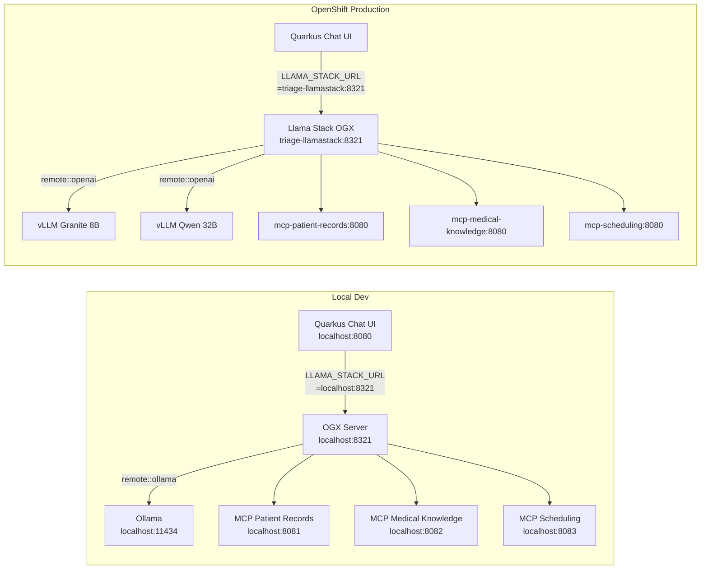

# Local Development Environment

## Design Principle

The Quarkus applications (chat UI + 3 MCP servers) remain **identical** between local dev and OpenShift production. All environment differences live in two places:

- **OGX config file** -- different per environment (local Ollama vs remote vLLM)
- **One env var** on the Quarkus chat UI -- `LLAMA_STACK_URL`

This makes the "local to prod" webinar story trivially demonstrable.

## What Changes Between Environments



| Component | Local Dev | OpenShift Prod | What Changes |
|---|---|---|---|
| Quarkus Chat UI code | identical | identical | nothing |
| Quarkus MCP server code | identical | identical | nothing |
| `LLAMA_STACK_URL` | `http://localhost:8321` | `http://triage-llamastack:8321` | env var only |
| `MODEL_NAME` | `triage-model` | `triage-model` | nothing (logical alias) |
| OGX inference provider | `remote::ollama` -> localhost:11434 | `remote::openai` -> vLLM svc URLs | OGX config file |
| OGX MCP connector URLs | `localhost:8081-8083` | k8s service names | OGX config file |
| OGX model mapping | `triage-model` -> Ollama model | `triage-model` -> Granite/Qwen | OGX config file |

## Prerequisites

- **Podman** with `podman compose` (or Docker with `docker compose`)
- **Ollama** installed and running (`ollama serve`)
- **uv** installed (`brew install uv` or see https://docs.astral.sh/uv/)
- **Java 25+** (for local `quarkus dev` only; container builds use UBI10 openjdk-25)

## Step 1: Set Up OGX in a Local Virtual Environment

Create a Python virtual environment inside the `ogx_configs/` directory using `uv`, keeping OGX isolated from the system Python:

```bash
cd ogx_configs/
uv venv .venv --python 3.12
uv pip install ogx ollama --python .venv/bin/python
```

The `.venv/` directory is gitignored. Run OGX via the venv-local binary:

```bash
ogx_configs/.venv/bin/ogx run ogx_configs/local-dev.yaml
```

Or activate the venv first:

```bash
source ogx_configs/.venv/bin/activate
ogx run ogx_configs/local-dev.yaml
deactivate
```

This keeps OGX completely isolated -- no global Python packages polluted. The `ogx_configs/` directory is the self-contained home for everything OGX: the venv, the local dev config, and the production reference config.

## Step 2: Pull an Ollama Model with Tool Calling Support

For closest parity with the production Granite model:

```bash
ollama pull granite3.3:8b
```

The `granite3.3:8b` model from IBM supports function calling and is the closest local equivalent to the production `Granite 3.3 8B Instruct` on vLLM.

Alternatively, `qwen3:14b` has excellent tool calling support and can be used instead by setting the `OLLAMA_MODEL` environment variable before starting OGX:

```bash
export OLLAMA_MODEL=qwen3:14b
```

Either model works -- OGX maps the logical alias `triage-model` to whichever you configure.

## Step 3: OGX Configuration Files

Two OGX config files live in `ogx_configs/`. See the actual files for the full configuration; below is a summary of the key differences.

### `ogx_configs/local-dev.yaml` -- Local Development

- Inference: `remote::ollama` pointing at `localhost:11434`
- MCP connectors: `localhost:8081-8083`
- Model alias: `triage-model` -> `granite3.3:8b` (or `$OLLAMA_MODEL`)

### `ogx_configs/openshift-prod.yaml` -- OpenShift Production (reference)

- Inference: `remote::openai` pointing at vLLM service URLs
- MCP connectors: k8s service names (`mcp-patient-records:8080`, etc.)
- Model aliases: `triage-model` -> `granite-3.3-8b-instruct`, plus `qwen-2.5-32b`

The diff between the two configs is the **entire "local to prod" story**: swap `remote::ollama` for `remote::openai`, change URLs from localhost to k8s service names. The Quarkus apps are untouched.

## Step 4: Quarkus App Configuration

### Chat UI (`triage-assistant/src/main/resources/application.properties`)

```properties
# Llama Stack connection -- only this URL changes between environments
quarkus.rest-client.llamastack.url=${LLAMA_STACK_URL:http://localhost:8321}

# Model name -- stays the same everywhere (logical alias resolved by OGX)
triage.model=${MODEL_NAME:triage-model}

# System prompt
triage.system-prompt=You are a clinical triage assistant for hospital nurses. \
  You help nurses during patient intake by looking up patient records, \
  assessing symptom urgency, checking drug interactions, and scheduling \
  specialist appointments. \
  IMPORTANT: You ASSIST the nurse. You do NOT make clinical decisions. \
  Always state the ESI triage level when assessing symptoms. \
  Flag red flags and recommended immediate actions clearly.
```

### MCP Servers

No AI-related config in MCP servers -- they are plain Quarkus apps with `@Tool` annotations. Each runs on the default port 8080 inside its container; port mapping is handled by Podman Compose.

## Running Locally

### Step 1: Start MCP servers with Podman Compose

Build and start all three MCP servers as containers:

```bash
podman compose up --build
```

Once the images are built, subsequent starts are faster:

```bash
podman compose up -d
```

This starts all three MCP servers in the background, mapped to the expected ports:

| Container | Host Port |
|-----------|-----------|
| mcp-patient-records | 8081 |
| mcp-medical-knowledge | 8082 |
| mcp-scheduling | 8083 |

To stop them:

```bash
podman compose down
```

### Step 2: Start Ollama (if not already running)

```bash
ollama serve
```

### Step 3: Start OGX

```bash
ogx_configs/.venv/bin/ogx run ogx_configs/local-dev.yaml
```

OGX connects to the MCP servers on `localhost:8081-8083` and to Ollama on `localhost:11434`.

### Step 4: Start the Chat UI (once built)

```bash
cd triage-assistant && quarkus dev
```

Open `http://localhost:8080` and interact with the triage assistant.

### Alternative: Quarkus Dev Mode (without containers)

For rapid iteration on MCP server code, run them directly with `quarkus dev` instead of Podman:

```
Terminal 1: cd mcp-patient-records && quarkus dev -Dquarkus.http.port=8081
Terminal 2: cd mcp-medical-knowledge && quarkus dev -Dquarkus.http.port=8082
Terminal 3: cd mcp-scheduling && quarkus dev -Dquarkus.http.port=8083
```

## Port Assignments

| Service | Port |
|---------|------|
| triage-assistant (Quarkus Chat UI) | 8080 |
| mcp-patient-records | 8081 |
| mcp-medical-knowledge | 8082 |
| mcp-scheduling | 8083 |
| OGX server | 8321 |
| Ollama | 11434 |

## Local to Production Transition

Moving from local dev to OpenShift requires **zero code changes**:

1. **Quarkus apps**: Set `LLAMA_STACK_URL` env var in the OpenShift Deployment to point at the Llama Stack service instead of localhost
2. **OGX config**: The `LlamaStackDistribution` CR on OpenShift uses the equivalent of `ogx_configs/openshift-prod.yaml` -- different inference providers (vLLM instead of Ollama) and different MCP connector URLs (k8s service names instead of localhost)
3. **Model name**: Stays `triage-model` everywhere -- it is a logical alias resolved by OGX's routing table
4. **MCP connector IDs**: Stay `mcp::patient-records`, `mcp::medical-knowledge`, `mcp::scheduling` everywhere -- only the backing URLs change in OGX config
